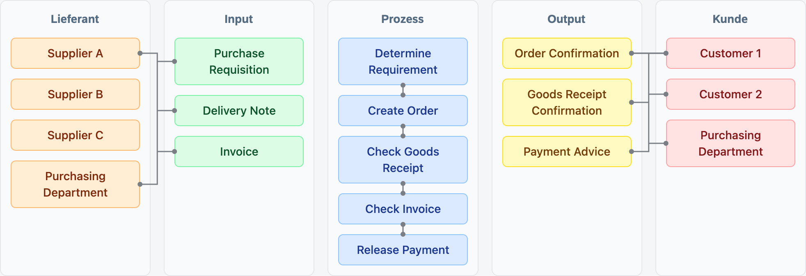
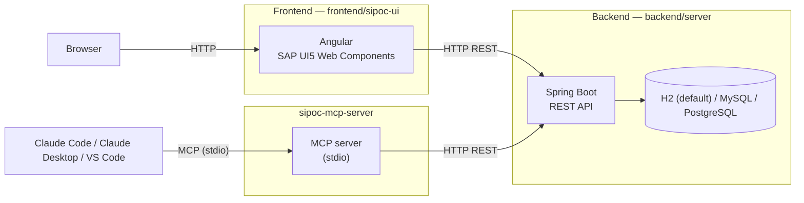

# SIPOCs



[](backend/server/pom.xml)
[](backend/server/pom.xml)
[](frontend/sipoc-ui/package.json)
[](frontend/sipoc-ui/package.json)
[](frontend/sipoc-ui/package.json)
[](frontend/sipoc-ui/package.json)
[](docker-compose.yml)
[](sipoc-mcp-server)

An application for managing SIPOC diagrams (**S**upplier, **I**nput, **P**rocess, **O**utput,
**C**ustomer) — a process-improvement/business-analysis tool. Also called "LIPOK" in the project
(German: Lieferant, Input, Prozess, Output, Kunde).

📄 **[Project overview / GitHub Pages](https://tobias-a-hofmann.github.io/sipocs/)**

## Screenshots

| | | | | |
| --- | --- | --- | --- | --- |
| [](images/screenshot-1.svg) | [](images/screenshot-2.svg) | [](images/screenshot-3.svg) | [](images/screenshot-4.svg) | [](images/screenshot-5.svg) |

*Placeholders — click a thumbnail to open the full-size image; replace the files in
[`images/`](images/) and [`images/thumbs/`](images/thumbs/) with real screenshots.*

## Example SIPOC

A blank SIPOC template is available at [`SIPOC_TEMPLATE.md`](SIPOC_TEMPLATE.md). Here's a filled-in
example (procurement process), translated to English for readability — the actual
[Markdown export](#exporting-a-lipok-to-markdown) always uses the fixed German section/column
headers (`Metadaten`, `Geschäftsobjekt`, `LIPOK` / `Lieferant`, `Input`, `Prozess`, `Output`,
`Kunde`), since those are hardcoded in `LipokExportService`:

```md
# Procurement Process

f64e5850-91ac-48c5-beb6-a1c834cbeb5f Procurement Process

SIPOC for the procure-to-pay process

## Metadata

| creator | date | time |
| --- | --- | --- |
| system | 2026-08-02 | 12:23:20 |

| last editor | date | time |
| --- | --- | --- |
| system | 2026-08-02 | 12:23:20 |

## Business Object

| Business Object | Description |
| --- | --- |
| Purchasing Contract | Contract for purchasing |
| Order Contract | Contract for orders |
| Material BOM | Material-related BOM |

## SIPOC

| Supplier | Input | Process | Output | Customer |
| --- | --- | --- | --- | --- |
| Supplier A | Purchase Requisition | Determine Demand | Order Confirmation | Customer 1 |
| Supplier B | Delivery Note | Create Order | Goods Receipt Confirmation | Customer 2 |
| Supplier C | Invoice | Inspect Goods Receipt | Payment Advice | Purchasing Department |
| Purchasing Department |  | Verify Invoice |  |  |
|  |  | Release Payment |  |  |
```

## Quick start

> (requires Java 25 and Node.js/npm to already be installed, see below)

Run sipoc.[sh/cmd] start to start the app. This starts the frontend and backend using H2 as database.

- Frontend: [http://localhost:4200](http://localhost:4200)
- Backend: Swagger UI at [http://localhost:8080/swagger-ui/index.html](http://localhost:8080/swagger-ui/index.html)

### macOS

`sipoc.sh` starts/stops the whole solution — backend, frontend, and mock data seeding — in one go:

```sh
./sipoc.sh start   # start backend + frontend, wait until both are up, seed mock data
./sipoc.sh status  # check what's currently running
./sipoc.sh stop    # stop backend + frontend
```

### Windows

The Windows wrapper uses the same subcommand structure as the Unix script:

```bat
sipoc.bat start   # start backend + frontend, wait until both are up, seed mock data
sipoc.bat status  # check what's currently running
sipoc.bat stop    # stop backend + frontend
```

If the project folder is on your `PATH`, you can also call it as `sipoc start` / `sipoc status` / `sipoc stop`. In PowerShell, the equivalent is usually `./sipoc.bat start` or `./sipoc.ps1 start`.

## Quick start (Docker)

No local Java/Node toolchain required — just Docker. `docker-compose.yml` builds and runs the
backend and frontend as containers; `COMPOSE_PROFILES` picks the backend's database — H2 (default,
no flag needed), MySQL, or PostgreSQL:

| Database | Start | Stop (keep data) | Stop + wipe data |
| --- | --- | --- | --- |
| H2 (default, in-memory) | `docker compose up --build` | `docker compose down` | *(nothing to wipe — H2 never persists)* |
| MySQL | `COMPOSE_PROFILES=mysql docker compose up --build` | `docker compose down` | `docker compose down -v` |
| PostgreSQL | `COMPOSE_PROFILES=postgresql docker compose up --build` | `docker compose down` | `docker compose down -v` |

- Backend: [http://localhost:8080](http://localhost:8080) (Swagger UI at `/swagger-ui/index.html`)
- Frontend: [http://localhost:4200](http://localhost:4200)

Same ports as the native setup below. With H2 (the default), data does not survive a restart, same
as running natively. With MySQL/PostgreSQL, `COMPOSE_PROFILES` starts the matching database
container alongside backend + frontend and points the backend at it in one go; data then persists
in a Docker volume across `docker compose down`/`up` cycles — use `docker compose down -v` to also
delete that volume and start from an empty database. Mock-data seeding is not wired into Compose;
run it separately against whichever setup is running (see [Loading mock data](#loading-mock-data)
below).

`COMPOSE_PROFILES` is a regular Docker Compose mechanism — it works the same via an exported shell
variable, inline before the command (as above), or in a `.env` file next to `docker-compose.yml`:

```sh
# .env
COMPOSE_PROFILES=postgresql
DB_NAME=lipokdb
DB_USERNAME=sipoc
DB_PASSWORD=change-me
```

With that `.env` in place, a plain `docker compose up --build` picks it up automatically.
`DB_NAME`/`DB_USERNAME`/`DB_PASSWORD` seed both the backend's datasource and the database
container's own credentials, so they stay in sync — see `docker-compose.yml` for the full list of
variables (including `DB_ROOT_PASSWORD` for MySQL's root user).

> **Security note:** the built-in `sipoc`/`sipoc` (and MySQL `root`/`root`) fallbacks are
> throwaway local-dev defaults. Neither the `mysql` nor `postgresql` container publishes a host
> port by default, so they're only reachable from other containers on the same Compose network —
> but always override the credentials above before running this anywhere reachable from an
> untrusted network (the API itself has no authentication either, see `SCHEMA.md`).

## Architecture

See [`docs/adr/`](docs/adr/) for the reasoning behind the stack and data-model choices below.



## Components

### Backend (`backend/server`)

See [`backend/server/README.md`](backend/server/README.md) for the full reference — standalone
Docker build/run, generating Javadoc, running a single test, loading mock data directly, etc.

Java 25, Spring Boot 4.1.0, Spring Data JPA. Schema is always derived from the entities (no
migration files) — `spring.jpa.hibernate.ddl-auto=update` on every profile. API docs are generated
via springdoc-openapi.

**Database** — selected via a Spring profile (`spring.profiles.active`, default `h2`), configured
in `backend/server/src/main/resources/application-{h2,mysql,postgresql}.properties`:

- **`h2` (default)** — in-memory (`jdbc:h2:mem:lipokdb`), zero config, data does not survive a
  restart. H2 console at [http://localhost:8080/h2-console](http://localhost:8080/h2-console)
  (JDBC URL `jdbc:h2:mem:lipokdb`).
- **`mysql`** / **`postgresql`** — a real, persistent database. Connection details come from
  `DB_HOST`/`DB_PORT`/`DB_NAME`/`DB_USERNAME`/`DB_PASSWORD` env vars (each has a sensible
  default — see the respective `application-*.properties` file).

Switch profiles with any of the standard Spring mechanisms, e.g.:

```sh
SPRING_PROFILES_ACTIVE=postgresql DB_HOST=localhost DB_PASSWORD=... ./mvnw spring-boot:run
```

(For the Docker Compose setup, see [Quick start (Docker)](#quick-start-docker) above — one
`COMPOSE_PROFILES` variable switches both the container and the Spring profile.)

- **Schema** — the full entity/DTO model and every REST endpoint are documented in
  [`SCHEMA.md`](SCHEMA.md); read it before making model/API changes.
- **Swagger UI** — interactive API docs and a "try it out" console, once the backend is running:
  [http://localhost:8080/swagger-ui/index.html](http://localhost:8080/swagger-ui/index.html)
  (OpenAPI JSON at `/v3/api-docs`).

Run it locally with the default H2 database (requires Java 25, see `backend/server/pom.xml`):

```sh
brew install openjdk@25   # if not already installed
cd backend/server
./mvnw spring-boot:run
```

### Frontend (`frontend/sipoc-ui`)

See [`frontend/sipoc-ui/README.md`](frontend/sipoc-ui/README.md) for the full reference —
standalone Docker build/run, generating component docs (Compodoc), translations, scaffolding, etc.

Angular (standalone components, no NgModules) built on:

- **[SAP UI5 Web Components](https://ui5.sap.com/)** (`@ui5/webcomponents` /
  `@ui5/webcomponents-fiori`) for the UI widget library.
- **Tailwind CSS** for layout/utility styling.
- **`@ngx-translate`** for i18n (German + English UI strings).

Feature folders under `src/app/` mirror the backend aggregates (`business-partners/`, `gos/`,
`sipocs/`, `home/`, `shared/`).

Run it locally (requires Node.js and npm):

```sh
cd frontend/sipoc-ui
npm install
npm start
```

The app is then running on [http://localhost:4200](http://localhost:4200).

### MCP server (`sipoc-mcp-server`)

An [MCP](https://modelcontextprotocol.io) (Model Context Protocol) server that exposes the
backend's REST API as tools for LLM clients — one tool group per backend controller (business
partners, inputs, process steps, outputs, gos, lipoks including linking/export). See
[`sipoc-mcp-server/README.md`](sipoc-mcp-server/README.md) for the full tool list.

**Build and run:**

```sh
cd sipoc-mcp-server
npm install
npm run build
npm start   # stdio transport, requires the backend running on http://localhost:8080/api
```

Override the backend URL with `SIPOC_API_BASE_URL` if it's not running on the default host/port.

**VS Code** — add to `.vscode/mcp.json`:

```json
{
  "servers": {
    "sipoc-mcp-server": {
      "type": "stdio",
      "command": "node",
      "args": ["sipoc-mcp-server/dist/index.js"]
    }
  }
}
```

**Claude Code** — register it from the repo root:

```sh
claude mcp add sipoc-mcp-server -- node sipoc-mcp-server/dist/index.js
```

**Claude Desktop** — add to `claude_desktop_config.json`:

```json
{
  "mcpServers": {
    "sipoc-mcp-server": {
      "command": "node",
      "args": ["/absolute/path/to/sipocs/sipoc-mcp-server/dist/index.js"]
    }
  }
}
```

## Exporting a Lipok to Markdown

Every Lipok (SIPOC instance) can be exported as Markdown, either from the frontend or directly
against the backend API:

- **Single Lipok** — the "Export" button in the SIPOC detail view, or `GET /api/lipoks/{id}/export`,
  downloads one `.md` file named `<id>_<name>.md`.
- **All Lipoks** — the "Export all" button in the SIPOC list view, or `GET /api/lipoks/export`,
  downloads a `lipok-export.zip` containing one `.md` file per Lipok (same naming as above).

The Markdown is generated by `LipokExportService.buildMarkdown()` (`backend/server`) and always
has this structure — see [`docs/example-export.md`](docs/example-export.md) for a full example
generated from the seeded mock data:

| Section | Source | Content |
| --- | --- | --- |
| Title (H1) + id/name line | `Lipok.name`, `Lipok.id` | |
| Description paragraph | `Lipok.description` | |
| `## Metadaten` | `Lipok`'s audit fields | Two small tables: creator + created date/time, then last editor + last-updated date/time |
| `## Geschäftsobjekt` | `Lipok.gos` (via `LipokGo`) | One row per attached Go, with its name and description |
| `## LIPOK` | `Lipok.suppliers`/`inputs`/`processSteps`/`outputs`/`customers` | A 5-column table (Lieferant / Input / Prozess / Output / Kunde); each column simply lists that column's attached names in `position` order, padded with empty cells to the longest column |

**Known limitations of the current export** (also true for the `.md` files inside the zip):

- The `## LIPOK` table lines up columns by row position only — it does **not** reflect the
  fine-grained links (`LipokInput.supplier`/`processStep`, `LipokOutput.processStep`/customer
  links, process step predecessor order). A supplier and input on the same row aren't necessarily
  linked to each other.
- `Lipok.comments` are **not** included in the export.

## Loading mock data

CSV-based mock data and a TypeScript loader script live in [`tests/`](tests/) — see
[`tests/README.md`](tests/README.md) for usage, and [`SCHEMA.md`](SCHEMA.md) for the backend
data model it targets.
